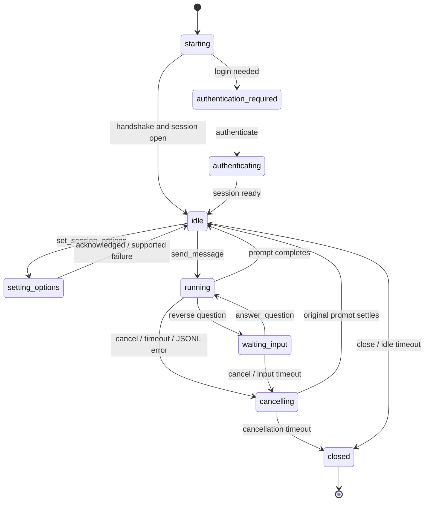
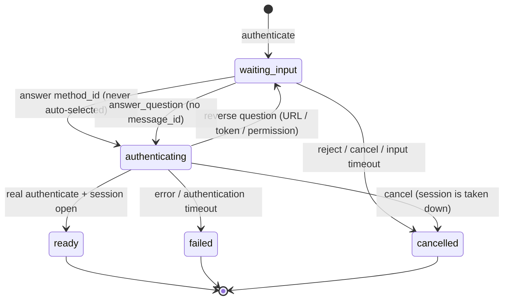

# Session operation state machine

The logic layer owns one operation slot per session. Starting, authentication, option
changes, a running message, pending input, and cancellation occupy that slot. A new
message or option change is accepted only while idle and ready.

A cancelled message becomes terminal only after the ACP prompt has settled or the transport
has closed. The slot stays occupied during cancellation, so a late completion cannot overlap
with a new prompt. `cancel_message` waits for this boundary; callers can then send their
replacement message. A cancellation timeout closes the session instead of allowing reuse.

`message_status` always addresses a message ID. Pending questions include original request
IDs and offered permission options; `answer_question` validates the pending question and
routes the selected answer using the original RPC ID. Completed/failed/cancelled messages
include a result, and a running message also carries an optional bounded `progress`
snapshot (`{text, reasoning, tool_calls}`).

## Interactive authentication

`authenticate` takes only `{session_id}` and returns a flow snapshot immediately; it never
blocks and never accepts a caller-chosen method.

A browser step (CodeBuddy auth URL, Agy stderr login URL, Codex device-code URL elicitation)
is normalized to a question whose message carries the full usable URL and whose schema asks
for `opened: true`; confirming only acknowledges and never flips the flow to `ready`. Method
selection is an information question requiring `method_id`; unsupported candidate types are
listed but never executed. `auth_status` returns the flow snapshot read-only while one exists,
and otherwise probes the harness. Cancelling a started login abandons the in-flight request and
closes the half-authenticated session (no `session/cancel` with a null id), so a late success
cannot revive it.

Unexpected or unsupported notifications are recorded without releasing or failing the message
slot. Invalid JSONL and oversized lines request cancellation before session termination.
Generic request, handshake, and authentication timeouts close the session to prevent late
state changes. Restart marks live sessions interrupted and preserves completed results.
